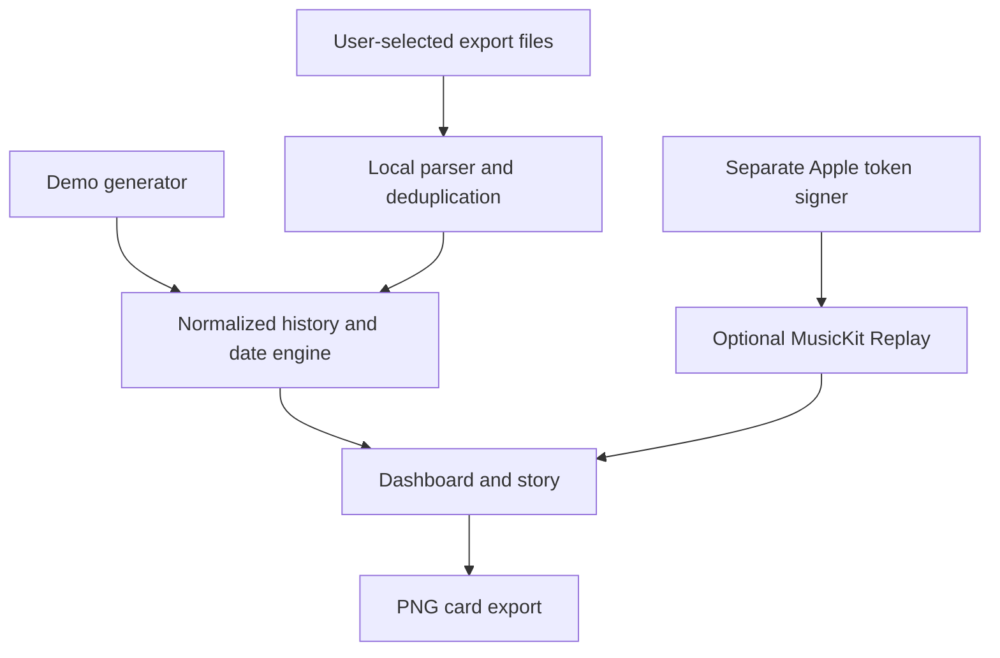

# Product, design and integration notes

## What the examples taught us

| Reference | What works | What Afterspin takes from it |
|---|---|---|
| [Spotify Wrapped fan experience](https://newsroom.spotify.com/2025-12-03/2025-wrapped-user-experience/) · [How Spotify makes it](https://newsroom.spotify.com/2025-12-03/how-your-wrapped-is-made/) · [video](https://www.youtube.com/watch?v=1-HSVoieS2U) | The big number is an opening, then stories like artist ranking and listening age give it context. Spotify uses its own listening data and editorial rules; the 2025 period ended in mid-November. | Five short chapters, one clear idea per card, and an image worth sharing. No unsupported taste psychographics or percentile claims. The one-year button is rolling, not a clone of Wrapped’s cutoff. |
| [Apple Music Replay](https://support.apple.com/en-ie/109356) · [walkthrough](https://www.youtube.com/watch?v=ru8MfCiwXek) | Eligible subscribers can inspect months, see a year-end highlight reel, and get a Replay playlist that updates weekly. | Keep the dashboard useful after the first reveal. Add custom date ranges, good coverage labels, and a readable chart. |
| [YouTube Music Recap](https://support.google.com/youtubemusic/answer/11418178) · [YouTube’s guide](https://blog.youtube/news-and-events/how-to-find-share-and-save-your-youtube-recap/) · [video search](https://www.youtube.com/results?search_query=YouTube+Music+Recap+2025+walkthrough) | Personalized recaps already exist on YouTube Music. YouTube Data API searches public content but explicitly blocks retrieval of personal watch history. | Use it as an experience reference. Do not present a public search feature as access to someone’s listening history. |
| [Gahan Rao’s portfolio](https://gahanrao.com/) · [directory entry](https://www.wallofportfolios.in/portfolios/gahan-n-rao/) | User-selected reference for a strong swirl motif and motion. | Use an independently modeled violet ribbon, a subtle oscillation, and a quieter dashboard. No copied imagery or source code. |

## Identity

The chosen lime mark is a single looping line, inspired by a record groove. The source includes two alternatives (Orbit and Pulse), the mark SVG, a source-rendered violet 3D sculpture, and the Blender script to modify it. Dark plum supports the purple motion, with chartreuse for actions and lavender for dates and secondary accents. Reduced-motion preferences stop the decorative ribbon.

## Data boundaries

- [Spotify Developer Policy](https://developer.spotify.com/policy) restricts analysis of Spotify Content or the Spotify Service, including derived listenership metrics. The [Developer Mode update](https://developer.spotify.com/blog/2026-02-06-update-on-developer-access-and-platform-security) also sets limits for a public rollout. This app does not use the Spotify Web API. Its local import path operates on files a listener explicitly selects from the [personal data export](https://support.spotify.com/ng/article/understanding-your-data/). Validate the intended commercial use and platform permissions before enabling account linking.
- Apple’s [Replay endpoint](https://developer.apple.com/documentation/applemusicapi/get-the-user%27s-replay-data) returns the latest eligible year with views such as top artists and songs. The [recent-track endpoint](https://developer.apple.com/documentation/applemusicapi/get-v1-me-recent-played-tracks) is not a complete dated listening ledger. Don’t offer arbitrary windows on Apple annual summaries.
- [YouTube Data API](https://developers.google.com/youtube/data/reference/rest/v3/playlistItems/list) cannot retrieve personal watch history. If YouTube is added later, evaluate a voluntary export workflow separately and keep ambiguous video-only records distinct from confirmed music listens.

## Architecture and rollout

For an Apple integration, set `appleTokenEndpoint` in `config.js` to an HTTPS endpoint you control. Return JSON with a `developerToken` property. Sign short-lived ES256 tokens server-side with the Apple Music key and allow the Pages origin (including any needed CORS response header). The browser uses MusicKit authorization and requests Apple’s annual summary. Keep the `.p8` key and signing logic off GitHub Pages. Test a subscribed user with eligible Replay data before making that button available in production.

Recommended sequence:

1. Test the browser edition on mobile with multiple real, consented export variants. Improve coverage diagnostics before adding any persistent account.
2. Add installable web app support if people want a quick mobile or Windows install. Keep the normalized history and date engine reusable.
3. If distribution requires stores or native account integrations, bring the shared engine into an Expo/React Native app for iOS and Android, and reuse the web interface in a Windows wrapper such as Tauri. Keep new storage opt-in and separate provider summaries from exact dated imports.
